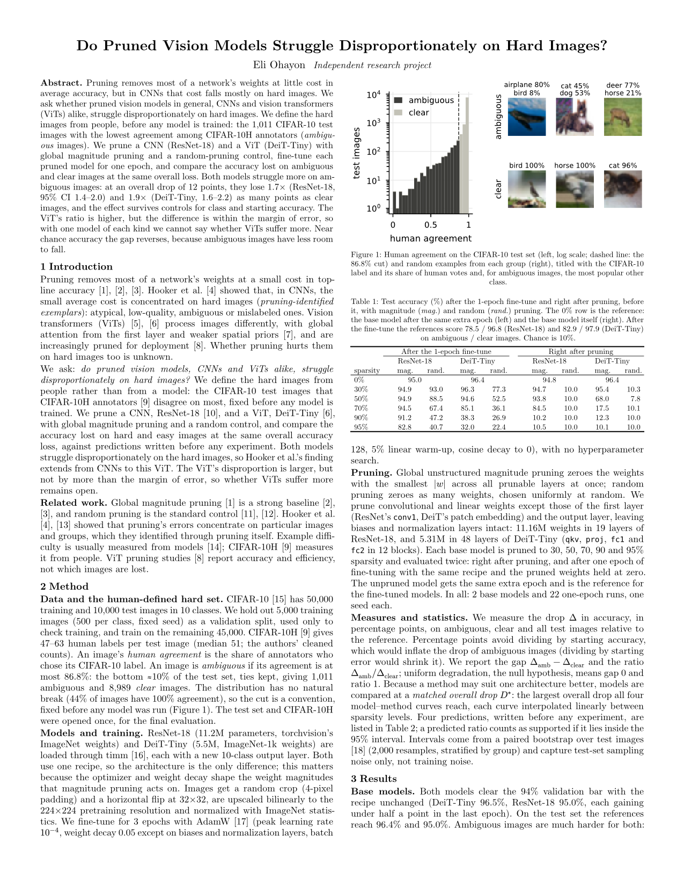
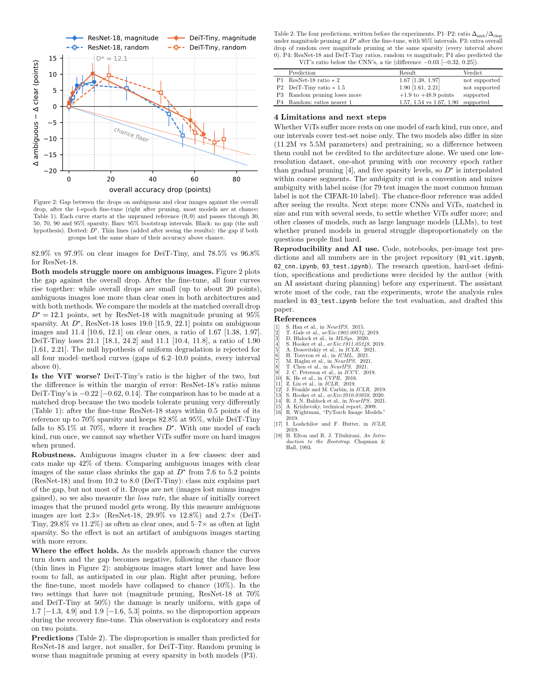

# Do pruned vision models struggle disproportionately on harder questions?

I took two vision models based on two different architectures, a ViT (DeiT-Tiny) and a CNN
(ResNet-18), and pruned them using magnitude pruning (setting the weights closest to zero to zero)
and random pruning. The harder questions are the CIFAR-10 test images that people disagreed on the
most (CIFAR-10H). We saw that both models struggled more on the harder questions: at the same
overall accuracy drop of 12 points, the CNN lost 1.7× and the ViT 1.9× as much accuracy on the hard
images as on the easy ones.

This study was a continuation of a study by Hooker et al. (2019), which focused only on CNNs. We
found that this effect also transfers to ViTs, in fact even being more prominent, although only one
model of each kind was checked and the difference between them was within the margin of error, so
we don't have enough information to say whether ViTs suffer worse on hard problems while pruned.
The next step is to check this phenomenon on different classes of ML models, such as LLMs.

## Paper

[Open the PDF](paper/paper.pdf)

[](paper/paper.pdf)
[](paper/paper.pdf)

## Files

| File | What it does |
|---|---|
| `01_vit.ipynb` | DeiT-Tiny: base model, then the prune-and-fine-tune sweep (validation only) |
| `02_cnn.ipynb` | ResNet-18: the same steps with the same recipe |
| `03_test.ipynb` | The only notebook that opens the test set and CIFAR-10H: drops, figures, predictions checked |
| `data.py`, `models.py`, `train.py`, `pruning.py`, `sweep.py` | Code shared by the notebooks |
| `results/` | Per-image test predictions, `drops.csv`, `summary.json`, figures |
| `paper/` | Typst source, bibliography, and the table and figure generators |
| `PLAN.md` | Research plan, decisions and predictions, written before the experiments |

**Reproduce** (Apple-silicon Mac, about 2 hours of training): put CIFAR-10 in `data/` and
CIFAR-10H's `cifar10h-counts.npy` in `data/cifar10h/`, then run notebooks 01, 02 and 03 in order
(each skips work already saved in `checkpoints/`). Build the paper and its page images (needs
`pip install typst`) with:

```bash
.venv/bin/python paper/make_table.py && .venv/bin/python paper/make_figures.py && .venv/bin/python -c "import typst; typst.compile('paper/paper.typ', output='paper/paper.pdf', root='.'); typst.compile('paper/paper.typ', output='paper/page-{p}.png', root='.', format='png', ppi=150)"
```
