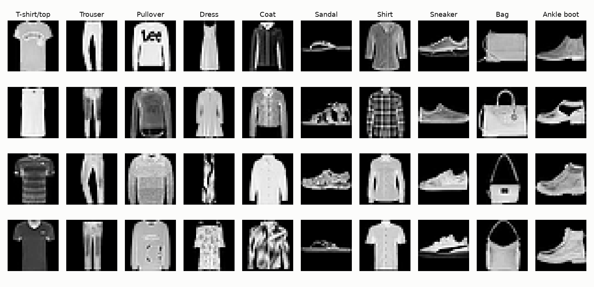
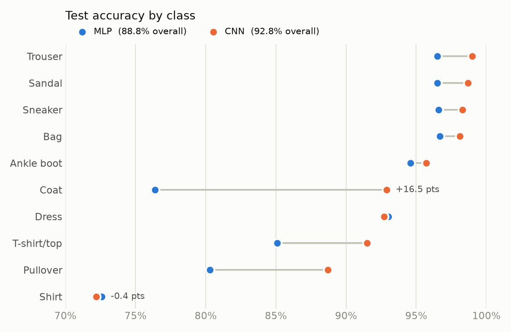
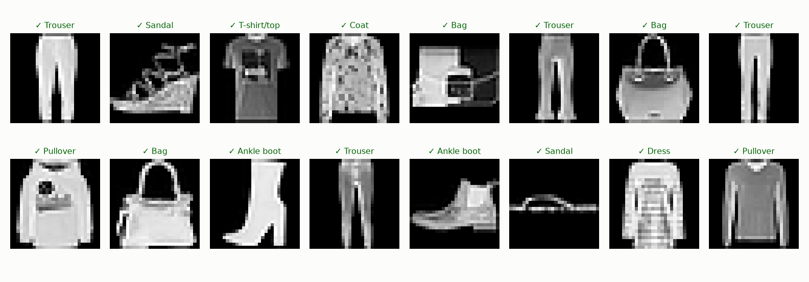
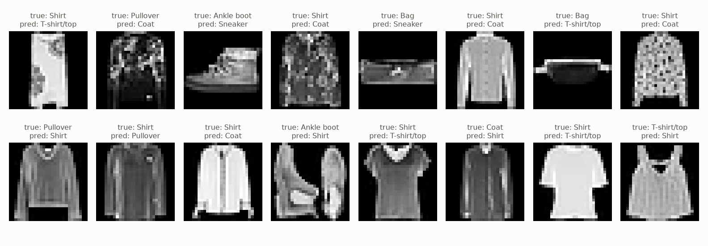

# Fashion-MNIST Image Classification

Two PyTorch image classifiers, a fully connected network (MLP) and a convolutional neural network (CNN), trained to recognise 10 kinds of clothing. The CNN reaches **92.8% test accuracy** with fewer parameters than the MLP, cutting errors by 35%.

| Model | Parameters | Test accuracy | Test errors (of 10,000) |
|---|---|---|---|
| MLP | 535,818 | 88.8% | 1,117 |
| CNN | 468,202 | **92.8%** | **722** |

## The dataset

[Fashion-MNIST](https://github.com/zalandoresearch/fashion-mnist) is 70,000 grayscale images (28×28 pixels) of Zalando clothing products in 10 classes: 60,000 for training and 10,000 for testing.



## The models

Both are defined in [`models.py`](models.py).

### MLP (fully connected)

Flattens each image into 784 pixel values and passes them through two hidden layers.

```
784 → Linear 512 → ReLU → Dropout → Linear 256 → ReLU → Dropout → Linear 10
```

Flattening throws away which pixels are next to each other, so the network has to learn every pattern separately at every position.

### CNN (convolutional)

Two convolutional blocks learn local visual features (edges, then larger shapes like collars, sleeves and soles), followed by a small classifier.

```
1×28×28 ─ conv block ─▶ 32×14×14 ─ conv block ─▶ 64×7×7 ─ flatten ─▶ 3136 → Linear 128 → Linear 10
```

Each conv block is `Conv 3×3 → BatchNorm → ReLU → Conv 3×3 → BatchNorm → ReLU → MaxPool 2×2 → Dropout`.

Because each 3×3 filter is shared across the whole image, the convolutional layers use only about 65K parameters. That's why the CNN can be smaller than the MLP and still more accurate.

## Results



| Class | MLP | CNN | Change |
|---|---|---|---|
| T-shirt/top | 85.1% | 91.5% | +6.4 |
| Trouser | 96.5% | 99.0% | +2.5 |
| Pullover | 80.3% | 88.7% | +8.4 |
| Dress | 93.0% | 92.7% | −0.3 |
| Coat | 76.4% | 92.9% | **+16.5** |
| Sandal | 96.5% | 98.7% | +2.2 |
| Shirt | 72.6% | 72.2% | −0.4 |
| Sneaker | 96.6% | 98.3% | +1.7 |
| Bag | 96.7% | 98.1% | +1.4 |
| Ankle boot | 94.6% | 95.7% | +1.1 |

- **The largest gains are on upper-body clothing.** Coat, Pullover and T-shirt/top have similar outlines and differ in details such as collars, zips and texture. The CNN's local filters pick up those details.
- **Shirt is still the hardest class.** It accounts for 278 of the CNN's 722 errors (38%). A shirt shares its shape with T-shirts, pullovers and coats, and at 28×28 pixels the telling details (buttons, collar) are only a few pixels wide.

### Example predictions

16 random test images with the CNN's prediction:



### Mistakes

A random sample of the CNN's errors. Most are confusions between upper-body clothes. A few are hard even for a person, and some labels look questionable (the "ankle boot" that looks like a sneaker, for example).



## Training setup

- **Data split:** the 60,000 training images are split into 55,000 for training and 5,000 for validation, using a fixed seed. The 10,000 test images are evaluated only once, after training.
- **Preprocessing:** pixels are scaled to [0, 1], then normalised with the training set's mean (0.2860) and standard deviation (0.3530).
- **Optimisation:** Adam (learning rate 1e-3), cross-entropy loss, batch size 128, 10 epochs.
- **Hardware:** runs on CUDA, Apple Silicon (MPS) or CPU, whichever is available. Both models train in a couple of minutes on an M-series Mac.

## Quick start

```bash
python3 -m venv .venv
source .venv/bin/activate
pip install -r requirements.txt

python train.py --model mlp           # downloads the dataset on first run
python train.py --model cnn
python make_figures.py                # regenerates the images in images/
```

Options: `--epochs`, `--batch-size`, `--lr`. Trained weights are saved to `checkpoints/<model>.pt`.

## Project structure

```
├── models.py          # MLP and CNN definitions
├── train.py           # data loading, training loop, evaluation, checkpointing
├── make_figures.py    # generates the README images from saved checkpoints
├── requirements.txt
└── images/            # figures used in this README
```

`data/`, `checkpoints/` and `.venv/` are created locally and excluded from git.

## Next steps

- Data augmentation (random flips and shifts) and a learning-rate schedule
- Residual (ResNet-style) blocks
- Moving to [CIFAR-10](https://www.cs.toronto.edu/~kriz/cifar.html), which has 32×32 colour photos of real-world objects
